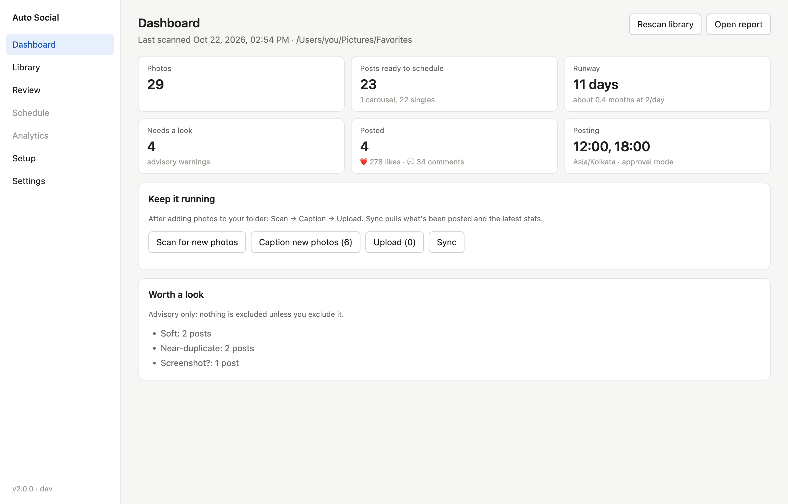
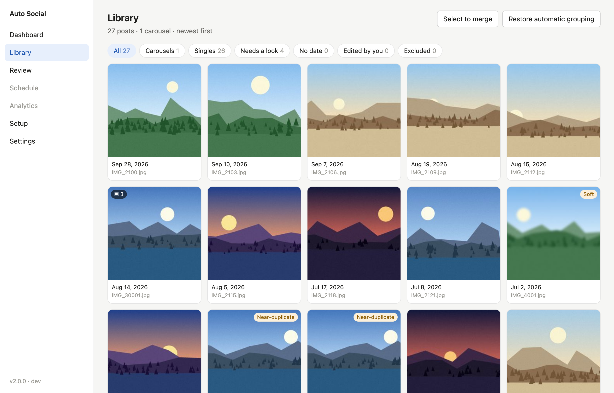
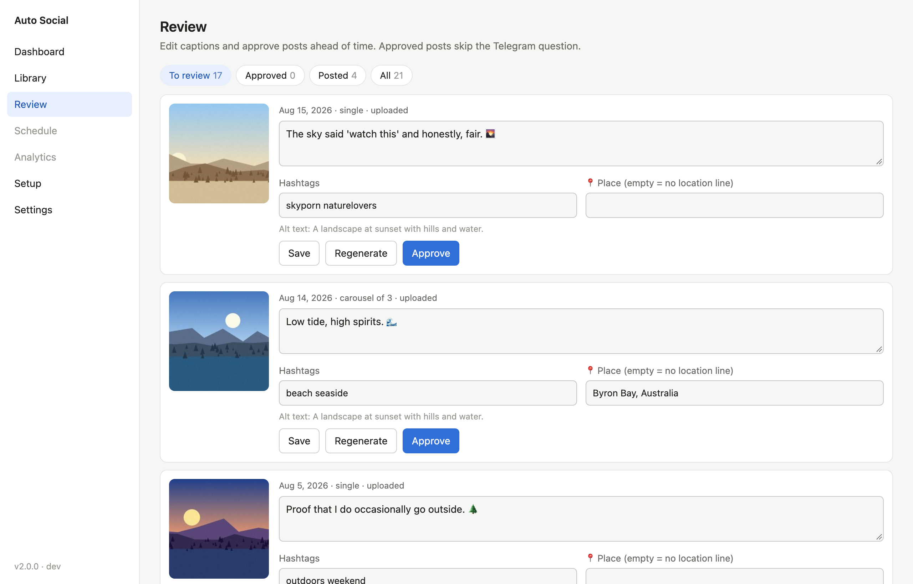
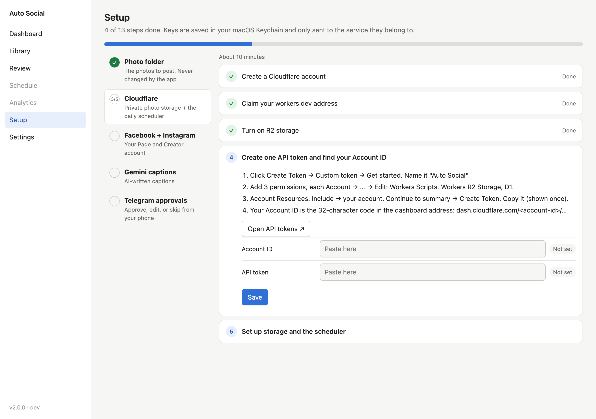
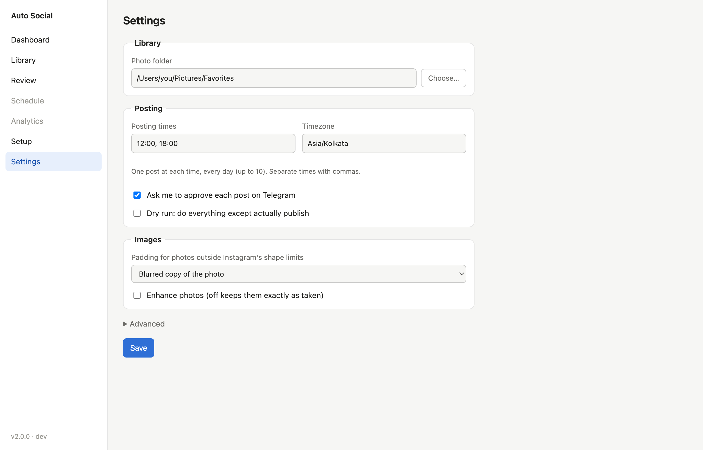

# Auto Social

**A desktop app for macOS and Windows that posts your favourite photos to your Facebook Page and
Instagram, a little every day, with captions written by AI.** You approve each post from Telegram
on your phone, or let it run on its own.

You set it up once. After that, posting runs in your own free Cloudflare account, so it keeps
going with your computer off.



**[⬇️ Download the latest release](../../releases/latest)** · [Full setup guide](docs/SETUP.md) · [Report a problem](../../issues)

---

## What it does

- **Works through your photo folder.** Point it at a folder of hand-picked photos (JPEG, HEIC or
  PNG). It never moves, renames, or changes your originals.
- **Groups bursts into carousels.** Photos taken in sequence a few minutes apart become one
  multi-photo post. You can merge or split groups yourself.
- **Flags what might need a look**, such as blurry shots, near-duplicates and screenshots. It
  never skips anything on its own; you decide.
- **Writes the captions.** Google's Gemini writes a short, first-person caption with a few hashtags,
  plus a 📍 location line when the photo has GPS. You can edit any caption.
- **Posts on a schedule.** One post a day (or several) to both Facebook and Instagram, newest
  photos first with some older favourites mixed in. Nothing is ever posted twice.
- **Asks before posting, if you want.** Telegram sends you each pick with ✅ Approve, ✏️ Edit and
  ⏭️ Skip. Unanswered posts are auto-approved 30 minutes before posting time (or held, if you
  prefer). When you trust it, send `/auto on`.
- **Shows how posts did.** It sends a weekly likes and comments summary to Telegram and shows the
  totals in the app.

## How it works

```
Your computer (the app)                      Your Cloudflare account (free)          You
 scan → group → caption → upload ───────────► private storage + daily scheduler ─────► Telegram ✅ ✏️ ⏭️
                                              posts to Instagram + Facebook
```

1. **The app** (on your computer) scans your folder, groups and captions the photos, and uploads
   them once to private storage in your Cloudflare account.
2. **A small scheduler** (in your Cloudflare account) picks each day's post, asks you on Telegram,
   and publishes it to Instagram and Facebook at your posting time. Then it deletes that photo
   from storage.
3. **The app** is only needed again to add new photos, edit captions, or check stats.

**Your accounts, your keys.** Everyone who uses Auto Social connects their own Facebook Page,
Instagram, Cloudflare, Gemini and Telegram. Keys are kept in your computer's keychain (macOS
Keychain or Windows Credential Manager) and are only sent to the service they belong to. Nothing
goes to whoever made or shared the app.

## Screenshots

| | |
|---|---|
| **Library**: carousels and "worth a look" warnings  | **Review**: edit captions and approve ahead of time  |
| **Setup**: a guided checklist with a check at every step  | **Settings**: posting times, approval, padding  |

*The screenshots use generated sample images and made-up captions.*

## What you need

| | Cost |
|---|---|
| A **Facebook** account (to create a Page and a free developer app) | Free |
| An **Instagram** account (it becomes a public Creator account) | Free |
| A **Cloudflare** account (storage and the scheduler) | Free tier. Turning on storage may ask for a card; normal use stays free |
| A **Google** account (Gemini writes the captions) | Free tier |
| **Telegram** on your phone (approvals) | Free |

First setup takes about **45–60 minutes**, once. The app's Setup screen guides you through every
step and checks each one.

## Install

Download from **[Releases](../../releases/latest)**:

| Your computer | Download | Needs |
|---|---|---|
| Mac with Apple M1, M2, M3… |  `AutoSocial-…-macOS-arm64.zip` | macOS 11 or newer |
| Mac with an Intel processor | `AutoSocial-…-macOS-intel.zip` | macOS 10.15 or newer |
| Windows PC | `AutoSocial-…-windows.zip` | Windows 10 or 11 |

Not sure which Mac you have? Open  → **About This Mac** and look at **Chip** or **Processor**.

**macOS**
1. Double-click the zip, then drag **Auto Social** into **Applications**.
2. The app isn't signed by Apple, so the first open is blocked. Try opening it once, then go to
   **System Settings → Privacy & Security**, scroll down, and click **Open Anyway**. (On macOS 14 or
   older: right-click the app → **Open** → **Open**.)

**Windows**
1. Unzip the **Auto Social** folder anywhere, for example in Documents.
2. Double-click **Auto Social.exe**. If you see "Windows protected your PC", click
   **More info → Run anyway**.

The warnings appear because the app isn't code-signed (signing costs money every year). They show
once.

## Quick start

1. **Open the app** and choose your photo folder. It scans the folder; nothing is uploaded yet.
2. **Go to Setup** and work down the list: Cloudflare → Facebook + Instagram → Gemini → Telegram.
   Each step has buttons that open the right page and a check before it gets a ✓.
3. **Dashboard → Caption new photos**, then look through **Review** if you like.
4. **Dashboard → Upload.** Your photos go to your private storage.
5. **Settings**: pick your posting time(s) and switch off **Dry run** when you're ready.

From then on, check Telegram each day, or send `/auto on` and let it run.

➡️ **[Full setup guide](docs/SETUP.md)**: every step in detail, daily life, Telegram commands,
troubleshooting and FAQ.

## Privacy

- Your photos stay on your computer until you upload them, and then go only to **your own**
  private Cloudflare storage. Each one is deleted from there once it's posted.
- GPS is removed from the uploaded copy. Location appears only as a 📍 line in the caption, if
  you keep it.
- Captions are written by Google Gemini. On Gemini's **free tier**, Google may use what you send
  to improve its products. The paid tier (about $0.001 a photo) doesn't, and is one billing switch
  away.
- Captions never name or guess who is in a photo.

## Terms

Auto Social is free to download and use. The source code isn't public. It's provided as is, with
no warranty: you're responsible for what you post and for following the Facebook, Instagram,
Cloudflare, Google and Telegram terms.
