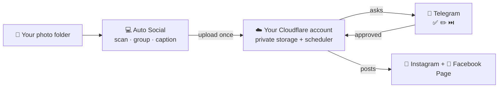
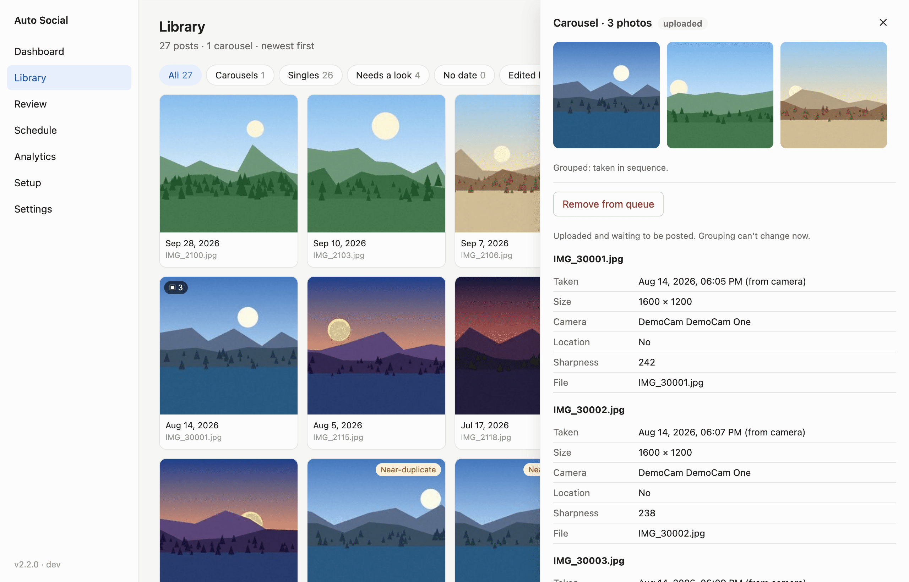
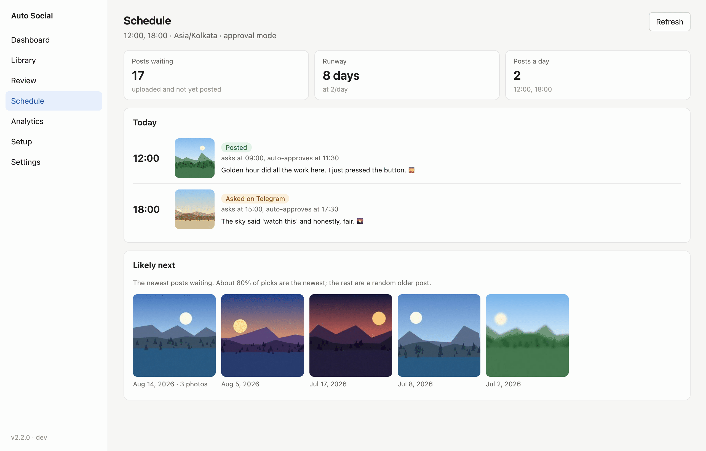
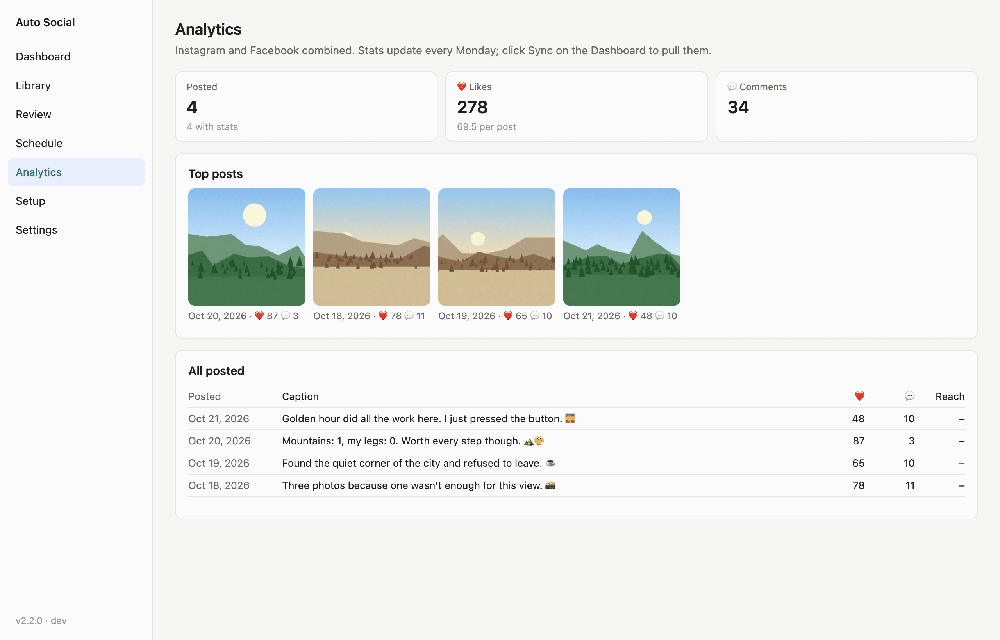
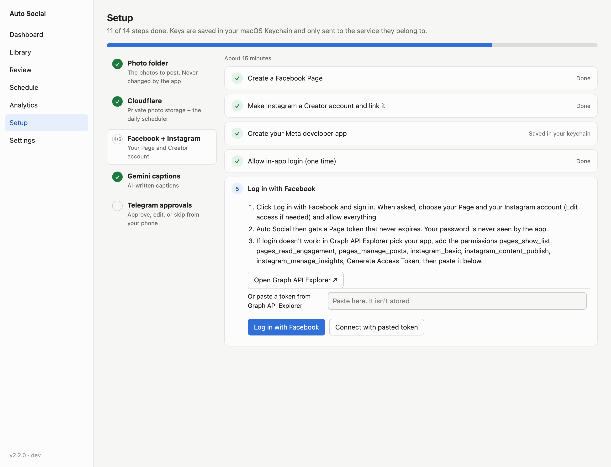

# Auto Social

**Your favourite photos, posted to your Facebook Page and Instagram a little every day, with
captions written by AI and a quick approval from your phone.**

A desktop app for **macOS** and **Windows**. Free to use, on free tiers.

&nbsp;
[**Full setup guide**](docs/SETUP.md) · [Report a problem](../../issues)

---

## What it does

You choose a folder of photos you love. Auto Social turns them into posts and publishes them on a
schedule, with your computer off.

| | |
|---|---|
| 📁 **Works from a folder** | JPEG, HEIC or PNG, with subfolders. It only reads your photos: originals are never moved, renamed or changed. |
| 🖼️ **Makes carousels** | Photos taken in sequence a few minutes apart become one multi-photo post. Merge or split groups yourself. |
| 🔎 **Flags what needs a look** | Blurry shots, near-duplicates and screenshots get a warning. Nothing is skipped unless you decide. |
| ✍️ **Writes the captions** | A short first-person caption, 1–3 hashtags and alt text, plus a 📍 place line when the photo has GPS. Edit any of it. |
| 📅 **Posts on a schedule** | One post a day, or several, to Instagram and Facebook together. Mostly your newest photos, with older favourites mixed in. Never the same photo twice. |
| 📱 **Asks you first** | Telegram sends each pick with ✅ Approve, ✏️ Edit and ⏭️ Skip. No answer? It's auto-approved 30 minutes before posting, or held if you prefer. Send `/auto on` when you trust it. |
| 📊 **Shows what's next and how it went** | A Schedule screen for today's picks, an Analytics screen for likes and comments, and a weekly summary on Telegram. |

## How it works

1. **The app** (on your computer) scans your folder, groups and captions the photos, and uploads
   them once to private storage in **your own** free Cloudflare account.
2. **A small scheduler** in that account picks each post, asks you on Telegram, and publishes it at
   your posting time. Then it deletes that photo from storage.
3. **Your computer can be off.** Open the app only to add photos, edit captions, or check the
   schedule and stats.

> 🔐 **Your accounts, your keys.** Everyone connects their own Facebook Page, Instagram,
> Cloudflare, Gemini and Telegram. Keys stay in your computer's keychain (macOS Keychain or
> Windows Credential Manager) and are only sent to the service they belong to. Nothing goes to
> whoever made or shared the app.

## A look inside

<table>
  <tr>
    <td width="50%"><b>Library</b>: every future post, with carousels and "worth a look" warnings </td>
    <td width="50%"><b>Post details</b>: reorder, split, exclude, or remove from the queue </td>
  </tr>
  <tr>
    <td><b>Review</b>: edit captions, regenerate, approve ahead of time </td>
    <td><b>Schedule</b>: today's posting times, picks and approvals, and what's likely next </td>
  </tr>
  <tr>
    <td><b>Analytics</b>: likes, comments and your top posts </td>
    <td><b>Settings</b>: posting times, approval, padding </td>
  </tr>
  <tr>
    <td><b>Setup</b>: a guided checklist with a check at every step </td>
    <td><b>Log in with Facebook</b>: no tokens to copy </td>
  </tr>
</table>

Screenshots use generated sample images and made-up captions.

## What you need

| Account | What it's for | Cost |
|---|---|---|
| A **Facebook** account | To create a Page and a free developer app | Free |
| An **Instagram** account | It becomes a public Creator account | Free |
| A **Cloudflare** account | Private photo storage and the scheduler | Free tier (turning on storage may ask for a card; normal use stays free) |
| A **Google** account | Gemini writes the captions | Free tier |
| **Telegram** on your phone | Approvals | Free |

⏱️ First setup takes about **45–60 minutes**, once. The app's **Setup** screen guides you through
every step and checks each one.

## Install

**[⬇️ Download the latest release](../../releases/latest)** and pick the file for your computer:

| Your computer | File | Needs |
|---|---|---|
| Mac with Apple M1, M2, M3… | `AutoSocial-…-macOS-arm64.zip` | macOS 11 or newer |
| Mac with an Intel processor | `AutoSocial-…-macOS-intel.zip` | macOS 10.15 or newer |
| Windows PC | `AutoSocial-…-windows.zip` | Windows 10 or 11 |

<b>Not sure which Mac you have?</b>

Open  → **About This Mac** and look at **Chip** (Apple M1, M2…) or **Processor** (Intel).

**macOS**
1. Double-click the zip, then drag **Auto Social** into **Applications**.
2. The first open is blocked because the app isn't signed by Apple. Try to open it once, then go to
   **System Settings → Privacy & Security**, scroll down, and click **Open Anyway**. (On macOS 14 or
   older: right-click the app → **Open** → **Open**.)
3. If macOS asks whether Auto Social may use a keychain item, click **Always Allow**.

**Windows**
1. Unzip the **Auto Social** folder anywhere, for example in Documents.
2. Double-click **Auto Social.exe**. If you see "Windows protected your PC", click
   **More info → Run anyway**.

> The warnings appear because the app isn't code-signed (signing costs money every year). They
> show only the first time.

## Quick start

1. **Open the app** and choose your photo folder. It scans the folder; nothing is uploaded yet.
2. **Go to Setup** and work down the list: **Cloudflare → Facebook + Instagram → Gemini → Telegram**.
   Each step has buttons that open the right page, and a check before it gets a ✓.
3. **Dashboard → Caption new photos**, then look through **Review** if you like.
4. **Dashboard → Upload.** Your photos go to your private storage.
5. **Settings:** pick your posting time(s), switch off **Dry run**, and click **Save**.

From then on, approve on Telegram each day, or send `/auto on` and let it run.

➡️ **[Full setup guide](docs/SETUP.md):** every step in detail with screenshots, daily life,
Telegram commands, updating, troubleshooting and FAQ.

## Updating

Download the new version and replace the app. Your settings, library and connections are kept.
Then open **Setup → Cloudflare → Update worker** once. Each [release's notes](../../releases) say
what changed.

## Privacy

- Your photos stay on your computer until you upload them, and then go only to **your own** private
  Cloudflare storage. Each one is deleted from there once it's posted.
- GPS is removed from the uploaded copy. The place appears only as a 📍 line in the caption, and you
  can delete it.
- Captions come from Google Gemini. On Gemini's **free tier**, Google may use what you send to
  improve its products. The paid tier (about $0.001 a photo) doesn't, and is one billing switch away.
- Captions never name or guess who is in a photo.

## Help

Something not working? Check [Troubleshooting](docs/SETUP.md#troubleshooting) and the
[FAQ](docs/SETUP.md#faq), then [open an issue](../../issues). In the app, **Dashboard → Details**
shows the last run's log.

## Terms

Auto Social is free to download and use. The source code isn't public. It's provided as is, with no
warranty. You're responsible for what you post and for following the Facebook, Instagram,
Cloudflare, Google and Telegram terms.
