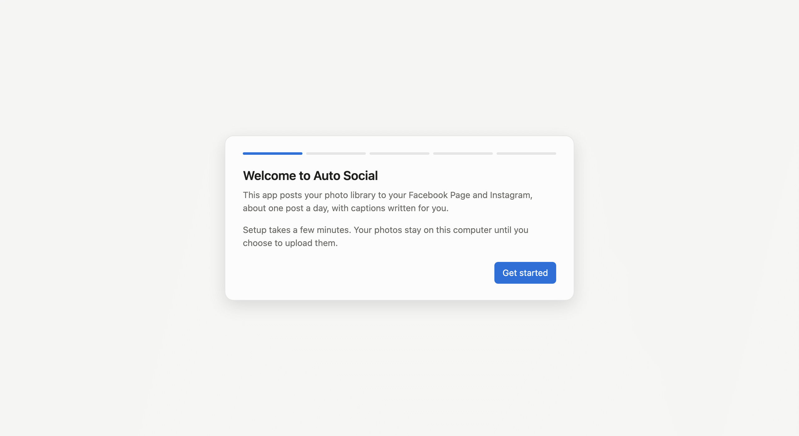

# Auto Social: full setup guide

Everything from installing the app to your first post, and how to use it day to day. The app's
**Setup** screen walks you through the same steps. Back to the [overview](../README.md).

**Contents:** [What you need](#what-you-need) · [1. Install the app](#1-install-the-app) · [2. First run: choose your photo folder](#2-first-run-choose-your-photo-folder) · [3. Cloudflare (storage + scheduler) · ~10 min](#3-cloudflare-storage--scheduler--10-min) · [4. Facebook Page + Instagram · ~15 min](#4-facebook-page--instagram--15-min) · [5. Captions: Gemini · ~3 min](#5-captions-gemini--3-min) · [6. Approvals: Telegram · ~3 min](#6-approvals-telegram--3-min) · [7. Caption, review, upload](#7-caption-review-upload) · [8. Choose your schedule and go live](#8-choose-your-schedule-and-go-live) · [Daily life](#daily-life) · [Adding photos later](#adding-photos-later) · [Updating the app](#updating-the-app) · [Where your data lives](#where-your-data-lives) · [Troubleshooting](#troubleshooting) · [FAQ](#faq) · [Known limitations](#known-limitations) · [Commands (power users)](#commands-power-users)

---

## What you need

| Account | What it's for | Cost |
|---|---|---|
| A personal **Facebook** account | To create a Page and a free Meta developer app | Free |
| An **Instagram** account | It becomes a public Creator account | Free |
| A **Cloudflare** account | Private photo storage and the daily scheduler | Free tier. Turning on storage may ask for a card; normal use stays free |
| A **Google** account | Gemini writes the captions | Free tier (see the note in [step 5](#5-captions-gemini--3-min)) |
| **Telegram** on your phone | Approve, edit or skip each post | Free |

⏱️ The first setup takes about **45–60 minutes**, once. The app's **Setup** screen guides you through
every step below and checks each one before giving it a ✓.

---

## 1. Install the app

Download from **[Releases](https://github.com/jumppack/auto-social-releases/releases/latest)**:

| Your computer | Download | Needs |
|---|---|---|
| Mac with Apple M1, M2, M3… | `AutoSocial-…-macOS-arm64.zip` | macOS 11 or newer |
| Mac with an Intel processor | `AutoSocial-…-macOS-intel.zip` | macOS 10.15 or newer |
| Windows PC | `AutoSocial-…-windows.zip` | Windows 10 or 11 |

Not sure which Mac you have? Open  → **About This Mac** and look at **Chip** or **Processor**.

### macOS
1. Double-click the zip, then drag **Auto Social** into **Applications**.
2. The app isn't signed by Apple, so the first open is blocked. Try to open it once, then go to
   **System Settings → Privacy & Security**, scroll down, and click **Open Anyway** next to
   "Auto Social". (On macOS 14 or older: right-click the app → **Open** → **Open**.)
3. If macOS asks whether Auto Social may use a key from your keychain, click **Always Allow**. This
   can happen once per key after installing a new version.

### Windows
1. Unzip the **Auto Social** folder anywhere, for example in Documents.
2. Double-click **Auto Social.exe**. If you see "Windows protected your PC", click
   **More info → Run anyway**.
3. Nothing else to install: the app uses Microsoft Edge WebView2, which is built into Windows 10 and 11.

> The warnings appear because the app isn't code-signed. They only show the first time.

---

## 2. First run: choose your photo folder

A short welcome wizard opens the first time.



1. **Get started → Choose folder…** and pick the folder with the photos you want to post.
   Subfolders are included.
2. **Scan this folder.** The app reads dates, merges identical copies, groups bursts into
   carousels, and flags possible problems. Nothing is uploaded yet.
3. **When should posts go out?** Pick a posting time (or several, separated by commas) and your
   timezone. Leave **"Ask me to approve each post"** on for now.
4. **Open library.**

### Look through your library (optional)


- **Library** shows every future post, newest first. Use the chips to filter: **Carousels**,
  **Needs a look**, **No date**, **Edited by you**, **Excluded**.
- **Click a post** to see its details. There you can reorder carousel photos (◀ ▶), remove a photo
  from a carousel, **Split** a carousel, or **Exclude** a post so it's never posted.
- **Select to merge** combines several posts into one carousel. **Restore automatic grouping** undoes
  your grouping edits.


> Warnings are only advice. Nothing is excluded unless you exclude it.

---

> **Steps 3–6 are also in the app.** Open **Setup**: each service has numbered steps, buttons that
> open the right page, paste fields that catch a wrong paste, and a check before each ✓.

## 3. Cloudflare (storage + scheduler) · ~10 min

Cloudflare stores your prepared photos **privately** and runs the small program (the "worker") that
posts every day.


**3a. Create the account.** Sign up at https://dash.cloudflare.com/sign-up and verify your email.
Skip any "add a website" prompts.

**3b. Claim your workers.dev address.**
1. In the left sidebar, open **Compute → Workers & Pages**.
2. If it asks you to choose a **workers.dev subdomain**, pick any name.
3. Don't create anything else. The app does that.

**3c. Turn on R2 storage.**
1. Sidebar: **Storage & databases → R2 object storage**.
2. Click the button to start: *Purchase R2 plan*, *Get started* or *Enable R2*.
3. Add a card if asked. The free allowance is 10 GB; a photo library uses about 1 GB.
4. **Don't create a bucket.** The app creates a private one.

**3d. Create one API token.**
1. In the app: **Setup → Cloudflare → Create the token**. Cloudflare opens with the name
   `Auto Social` and the three permissions already filled in: **Account** → `Workers Scripts`,
   `Workers R2 Storage` and `D1`, each **Edit**.
2. **Account Resources:** Include → *your account*. Leave the rest empty.
3. **Continue to summary → Create Token**, then **copy the token now**. It's shown only once.

> If the permissions aren't filled in, open https://dash.cloudflare.com/profile/api-tokens →
> **Create Token → Custom token → Get started**, name it `Auto Social`, and add those three rows yourself.

**3e. Find your Account ID.** It's the 32-character code in the dashboard address
(`dash.cloudflare.com/<account-id>/…`). It's also on the Workers & Pages overview.

**3f. Connect it.**
1. In the app: **Setup → Cloudflare**. Paste the **Account ID** and the **API token**, then click **Save**.
2. Click **Set up Cloudflare**. In about a minute the app creates a private bucket, a database and
   your worker, and switches on the schedule.
3. Click **Check connection**. Every line should show ✓, including *Bucket has no public address*
   and the upload, signed-link and cleanup test.

> It only touches things named `autosocial-…`. Other workers you already have are left alone. It
> uses 1 of your account's 5 scheduled triggers.

---

## 4. Facebook Page + Instagram · ~15 min

**4a. Create a Facebook Page.**
1. While logged in to your personal account, go to https://www.facebook.com/pages/create.
2. Pick a **name** (what followers see) and a category, such as *Digital creator*, *Photographer*
   or *Personal blog*.
3. Click **Create Page**. Inviting friends is optional.

> **Who sees Page posts?** Anyone can, because Pages are public. They don't appear on your personal
> timeline, and friends only see them if they follow the Page.

**4b. Make Instagram a Creator account** (in the Instagram app).
1. **Profile → ☰ → Account type and tools → Switch to professional account → Creator**.
2. Pick a category and finish. The account becomes **public**.

**4c. Link Instagram to the Page** (on facebook.com).
1. Switch to your Page: click your profile picture, then choose the Page.
2. **Settings & privacy → Settings → Linked accounts → Instagram → Connect account**.
3. Log in to Instagram when asked.

**4d. Create your Meta developer app.**
1. Go to https://developers.facebook.com and click **Get started** if you've never used it. You may
   need to verify a phone number.
2. **My Apps → Create app**.
   - **Name:** anything, for example `Auto Social`.
   - **Use case:** **Other** → app type **Business**.
   - If asked about a business portfolio: **"I don't want to connect a business portfolio yet"**.
3. Open **App settings → Basic** and copy the **App ID** and the **App secret** (click *Show*).
4. In the app: **Setup → Facebook + Instagram**. Paste both and click **Save**.

> The developer app stays in "development mode". That's fine: you're the admin of your Page and
> Instagram, so no Meta review or business verification is needed.

**4e. Allow in-app login** (one time, in your developer app).
1. In the developer dashboard's sidebar, open **Facebook Login for Business → Settings**. If it isn't
   there: **Add product → Facebook Login for Business → Set up**.
2. Under **Client OAuth settings**, turn on **Client OAuth login** and **Embedded browser OAuth
   login**, then **Save changes**.
   - Leave **Valid OAuth Redirect URIs** empty.
   - A banner saying Facebook Login for Business "requires advanced access" is fine to ignore. It
     doesn't apply to you as the app's admin.

**4f. Log in and connect.**


1. In the app: **Setup → Facebook + Instagram → Log in with Facebook**.
2. A Facebook window opens. Sign in, **select your Page and your Instagram account** (click
   **Edit access** if needed), and allow everything. The window closes by itself.
   - The app turns the login into a Page token that never expires and finds your Instagram account.
   - Your Facebook password is never seen by the app.
3. Click **Check connection**. You should see 5 ✓: *never expires, all 6 permissions, your Page,
   your Instagram, publishing quota*.

<details><summary><b>If Log in with Facebook doesn't work:</b> use Graph API Explorer instead</summary>

1. Open **Graph API Explorer**: https://developers.facebook.com/tools/explorer
2. On the right, set **Meta App** to *your app* and **User or Page** to **User Token**.
3. Under **Permissions**, add all six: `pages_show_list`, `pages_read_engagement`,
   `pages_manage_posts`, `instagram_basic`, `instagram_content_publish`, `instagram_manage_insights`.
4. Click **Generate Access Token**. In the Facebook window, select your Page and your Instagram
   account, and allow everything.
5. Copy the token from the **Access Token** box, paste it into **Setup → Facebook + Instagram**, and
   click **Connect with pasted token**. It isn't stored.

</details>

---

## 5. Captions: Gemini · ~3 min

1. Go to https://aistudio.google.com/apikey and click **Create API key**, then copy it.
2. In the app: **Setup → Gemini captions**. Paste it and click **Save and test**.

> **Free tier or paid?**
> - **Free tier:** captioning is free, but there's a daily limit, so a big library takes a day or
>   two. Google may use free-tier inputs, including your photos, to improve its products.
> - **Paid tier:** click **Set up billing** next to the key in AI Studio. It costs about
>   $0.0005–0.001 per photo, and your data isn't used for training.

---

## 6. Approvals: Telegram · ~3 min

1. In Telegram, open **@BotFather** and send `/newbot`.
   - Give it a display name, then a username ending in `bot`, for example `myname_autosocial_bot`.
2. BotFather replies with a **token** (`123456789:AA…`). Copy it.
3. In the app: **Setup → Telegram approvals**. Paste the token and click **Save**.
4. Open your bot in Telegram (`t.me/<your bot username>`), tap **Start**, and send it "hi".
5. In the app, click **Connect Telegram**. You'll get "✅ Auto Social is connected" on your phone.
6. In the same step, click **Update worker**. This switches on the bot's buttons and commands.

> The bot only answers **your** chat. Messages from anyone else are ignored.

---

## 7. Caption, review, upload

On the **Dashboard**, under **Keep it running**:
1. **Caption new photos.** Writes a caption, 1–3 hashtags and alt text for every post, plus a
   📍 place line when the photo has GPS. If the free Gemini limit is reached, it stops with "try
   again tomorrow"; click it again the next day and it carries on where it stopped.
2. **Review** (optional). Edit any caption, hashtags or place, **Regenerate** a caption, or
   **Approve** posts ahead of time. Approved posts skip the Telegram question.
3. **Upload.** Sends the prepared photos to your private storage. It's safe to stop and run again.
4. **Sync.** Pulls back what's been posted, the latest stats, and anything you approved or edited on Telegram.

Under each run, **Details** shows its step-by-step log.


> Captions never name or guess who's in a photo, and never invent dates, places or events.
> GPS is removed from the uploaded copies; the location only appears as the 📍 line.

---

## 8. Choose your schedule and go live


**Settings → Posting:**
- **Posting times** and **Timezone**, for example `12:00` and `Asia/Kolkata`. For more than one post a
  day, list several times: `12:00, 18:00`. Each time gets its own pick and its own Telegram request.
- **Ask me to approve each post on Telegram**: recommended for the first week.
- **Dry run**: everything runs except the actual publishing. Leave it on for a test day if you like,
  then turn it off to go live.

**Settings → Advanced:**
- *Ask for approval this many hours before posting*: default 3, so 09:00 for a 12:00 post.
- *Auto-approve unanswered posts this many minutes before posting*: default 30. Set it to 0 to hold
  unanswered posts instead.
- *Share of picks that are the newest photo*: default 0.8.

Click **Save**. The scheduler is updated straight away; the message under **Save** confirms it.

---

## Daily life

| When (your timezone) | What happens |
|---|---|
| Posting time − 3 h (e.g. 09:00) | Telegram sends the pick with **✅ Approve**, **✏️ Edit** (then send the new caption as a message) and **⏭️ Skip** (a new pick comes right away) |
| Posting time − 30 min (e.g. 11:30) | Still unanswered? It's **auto-approved**, and you're told. Send `/pause` to stop it |
| Posting time (e.g. 12:00) | Posted to Instagram and Facebook, then deleted from your cloud storage |
| Mondays from 10:00 | A weekly summary of likes and comments |

An approval request looks like this (with a small preview photo above it):

```text
🖼 Carousel of 3 photos

Golden hour did all the work here. I just pressed the button. 🌅

📍 Lisbon, Portugal

#sunset #goldenhour

[ ✅ Approve ]  [ ✏️ Edit ]  [ ⏭️ Skip ]
```

With several posting times, each one follows this timeline on its own, and its request starts with
"🕐 For 18:00".

**How posts are picked:** about 80% of the time it's your newest unposted photo, otherwise a random
older one. Photos without a real date are only picked in the random share. **Nothing is ever posted
twice:** each photo is tracked by a fingerprint of its contents, on your computer and in the cloud.

**Telegram commands:**

| Command | What it does |
|---|---|
| `/status` | Posts and days left, posted, failed, posting times, and the current mode |
| `/pause` · `/resume` | Stop or restart posting |
| `/auto on` | Fully automatic: no more daily questions |
| `/auto off` | Back to approval mode |
| `/help` | The command list |

After a week or so, send **`/auto on`** if you're happy with the captions.

**In the app:**

| Screen | Shows |
|---|---|
| **Schedule** | Today's posting times, what's picked for each and whether it's asked, approved or posted, and the posts most likely to go next |
| **Analytics** | Likes, comments and reach for every post, and your top posts. Updated every Monday; click **Sync** to pull them |
| **Review** | Captions, with "asked on Telegram" or "on hold" where that applies. **Remove from queue** pulls an uploaded post before it's posted |


---

## Adding photos later

1. Drop new photos into your library folder.
2. **Dashboard → Scan for new photos → Caption new photos → Upload → Sync.**

New photos slot into the order by when they were taken.

## Updating the app

1. Download the new version and replace the old app (Mac: drag it into Applications again; Windows:
   replace the folder). Your settings, library and connections are kept.
2. Open **Setup → Cloudflare → Update worker** once, so the scheduler gets the new features too.
   Until you do, posting keeps working and the app reminds you.

## Where your data lives

| What | macOS | Windows |
|---|---|---|
| Library index, settings, thumbnails | `~/Library/Application Support/AutoSocial` | `%LOCALAPPDATA%\AutoSocial` |
| Logs (including `jobs.log`) | `~/Library/Logs/AutoSocial` | `%LOCALAPPDATA%\AutoSocial\Logs` |
| Keys and tokens | Keychain, under "AutoSocial" | Credential Manager, under "AutoSocial" |
| Photos waiting to post | Your Cloudflare R2 bucket `autosocial-media` (private) | same |

**To remove everything:** send `/pause`, then in the Cloudflare dashboard delete the
`autosocial-worker` worker, the `autosocial-media` bucket and the `autosocial` D1 database. Then
delete the app and the folders above. Your original photos are never touched.

---

## Troubleshooting

| Problem | Fix |
|---|---|
| No message at approval time | Send `/status`: is it paused, are posts left? Then **Dashboard → Sync**, and look at **Schedule** |
| "❌ A post failed to publish" | It isn't retried automatically. Run **Setup → Facebook + Instagram → Check connection**. If the token is the problem, redo [step 4f](#4-facebook-page--instagram--15-min), then **Update worker** |
| "No Facebook Pages were shared with the app" | Redo 4f. In the Facebook window, click **Edit access** and tick your Page and Instagram |
| The Facebook login window shows an error | Check step 4e: both switches on, then save. Or use the Graph API Explorer fallback in 4f |
| "That doesn't look like a … token" when saving | The wrong thing was on your clipboard. Copy the value again |
| Caption run stopped ("try again tomorrow") | The free Gemini daily limit was reached. Click **Caption new photos** again tomorrow |
| Scan says the folder isn't available | The drive isn't connected. Nothing is marked missing until it's back |
| Save says "Not sent to the scheduler yet" | The worker couldn't be reached. Click **Dashboard → Sync** later; the change is kept |
| "Your worker is older than this app" | **Setup → Cloudflare → Update worker** |
| Changed your Facebook password | Redo step 4f, then **Update worker** |
| Something else | **Dashboard → Details** shows the last run's log; the full log is in the logs folder ([Your data](#where-your-data-lives)) |

## FAQ

**Does my computer need to be on?** Only for setup, captioning and uploading. Daily posting runs in
your Cloudflare account.

**What does it cost?** Nothing on free tiers. The paid Gemini tier is optional and costs about $0.50
for a 500-photo library.

**Who can see my photos before they're posted?** Nobody. The storage bucket is private. Instagram and
Facebook fetch each photo through a link that expires after an hour, and only you get the Telegram
previews.

**Can I stop one photo from being posted after uploading?** Yes. In **Review**, or in the post's
details in **Library**, click **Remove from queue**. It's deleted from your cloud storage. To post it
after all, click **Include in posting** in Library, then **Upload**.

**Can I edit a caption after uploading?** Yes. Edit it in **Review** (the cloud copy updates at once),
or use ✏️ on Telegram. Telegram edits show up in the app after a **Sync**.

**Will my Facebook friends see the posts?** Only if they follow your Page. Page posts don't appear on
your personal timeline.

## Known limitations

- **No video.** Single photos and carousels only, to a Facebook Page and Instagram.
- **A posting time more than an hour late is skipped for that day.** If the scheduler is first set
  up, or a time is added, after that time has passed, it starts the next day. This prevents a burst
  of posts or late-night requests.
- **Unsigned builds** show a warning on first launch (see [Install](#1-install-the-app)).

---

## Commands (power users)

When running from source, `autosocial` means `.venv/bin/autosocial` in the project folder.

| Command | What it does |
|---|---|
| `autosocial ui` | Open the app |
| `autosocial status` | Settings and library counts |
| `autosocial scan [--open]` | Scan the library and write an HTML report |
| `autosocial caption --sample N` / `--all` / `--item ID` | Generate captions |
| `autosocial upload [--limit N]` | Upload captioned posts (resumable) |
| `autosocial sync` | Push settings; pull posted/failed posts, Telegram approvals and edits, and stats |
| `autosocial setup-cloudflare [--dry-run]` | Create or update the bucket, database and worker |
| `autosocial verify-cloudflare` · `verify-meta` | Connection checks |
| `autosocial meta-login [--no-save]` | Log in with Facebook in a window (`--no-save` only tests it) |
| `autosocial test-post [--item ID] [--live]` | Publish one post end to end (dry run by default) |
| `autosocial request-approval --item ID` | Send a Telegram approval request now |
